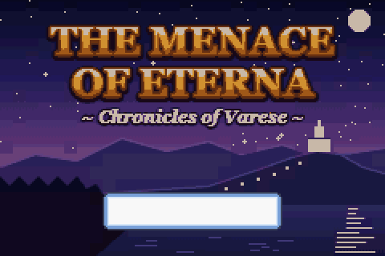
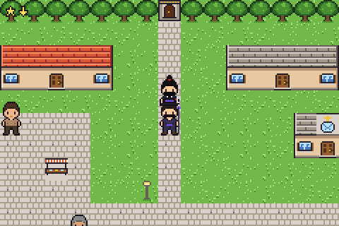
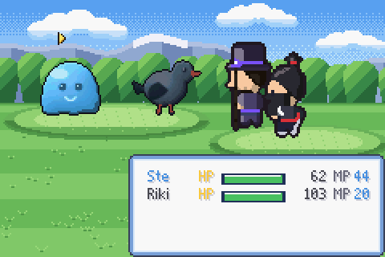
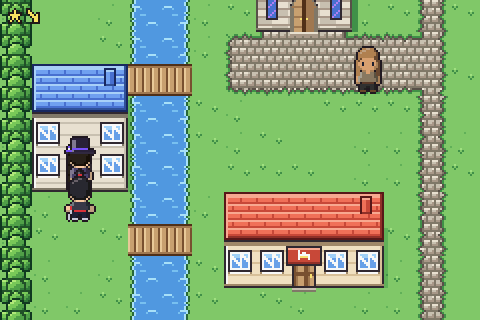
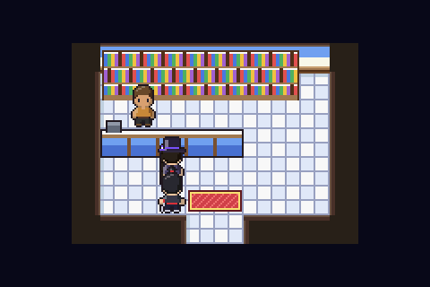
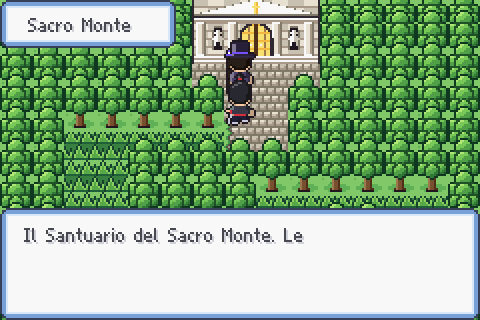
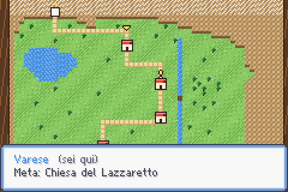

# The Menace of Eterna — versione Game Boy Advance

ROM per GBA del gioco web *The Menace of Eterna ~ Chronicles of Varese* (cartella `../RPG`):
stessa trama, stessi personaggi, mostri, abilità, oggetti e dialoghi, con grafica e giocabilità da GBA.

  
  

## Giocare

Apri `menace.gba` (copia di `build/menace.gba`) con un emulatore GBA (per esempio mGBA).

| Tasto | Azione |
|---|---|
| Croce | cammina (a caselle); tieni premuto **B** per correre |
| **A** | parla, apri forzieri, conferma |
| **B** | annulla |
| **SELECT** | sali o scendi dalla cavalcatura (asinello a Castiglione, cavallo nel castello di Jerago); in sella si va più veloci, col cavallo e B si galoppa |
| **START** | menu: squadra, oggetti, equipaggiamento, missioni, mappa, salvataggio |
| **L / R** | nella mappa: R passa dalla pianta del paese alla provincia |

Tastiera in mGBA (configurata): **Ctrl** = A, **Alt** = B, **Spazio** = START, **Tab** = SELECT, **Q** / **W** = L / R, frecce = croce.

Si sceglie Ste o Riki; l'altro segue sulla mappa. La freccia in alto a sinistra indica la prossima tappa
della trama (o l'uscita da prendere per arrivarci). Il salvataggio va sulla SRAM della cartuccia.

Dal menu START, **Mappa** funziona come in Pokémon: dentro un paese o un edificio mostra la pianta del paese, fuori mostra la provincia con le strade che collegano i paesi; con R si passa dall'una all'altra. La stella che lampeggia è la tua posizione, il punto esclamativo la prossima meta; con la croce si scorrono i luoghi (negozio, locanda, chiesa, uscite).

Il salvataggio (menu START > Salva) va sulla memoria della cartuccia e dal titolo si riprende con **Continua**; un salvataggio di una versione vecchia del gioco viene ignorato.



## Cosa c'è

- Accademia, Varese, Vedano Olona, Castiglione Olona, Jerago, Samarate, gli interni e il Sacro Monte
  (le mappe compatte fatte a mano della versione web), più la mappa della provincia.
- Battaglie a turni con mostri e boss, abilità, combo Ste + Riki, mosse Limite, stati e debolezze,
  livelli, alleati che si uniscono (Pasq, Fabri, Elly, Vero, Mirko, Sofy), negozi, locande, missioni, forzieri.
- Musiche originali a due voci ed effetti sonori sui canali del GBA.

## Grafica

Lo stile è quello di Pokémon Rubino/Zaffiro. Ogni mappa è disegnata come un'unica immagine a colori pieni da
`tools/overworld.mjs`: terreni con bordi morbidi, alberi alti due caselle, case con tetto e facciata, chiese,
torri, acqua animata e interni arredati. `tools/gba-convert.mjs` la riduce in tile 8x8 senza doppioni, anche
specchiati, con al massimo 15 tavolozze di 15 colori assegnate tile per tile. Tetti e chiome finiscono sul livello
BG2, sopra gli sprite, così i personaggi ci passano dietro. Gli stessi strumenti producono gli sfondi di battaglia
(`tools/battlebg.mjs`) e il titolo.

I personaggi (`tools/chars.mjs`) sono modelli 16x32 con luce e ombra e un contorno automatico; in battaglia
sono ingranditi a 32x64 con Scale2x.

`node tools/preview-maps.mjs varese 1 1` salva in `build/` un'anteprima grande quanto lo schermo, senza compilare.

## Compilare

Serve l'**Arm GNU Toolchain** (`arm-none-eabi-gcc`) e Node.js. I dati e la grafica sono generati
dal gioco web in `../RPG` (Chrome serve per mostri e titolo).

```
node tools/build.mjs --assets    # rigenera gen/ dai dati del gioco web e compila build/menace.gba
node tools/build.mjs             # compila soltanto
```

## Controllo automatico

```
node tools/check.mjs
```

Compila la ROM di prova (`-DAUTOTEST`), la avvia in mGBA e con GDB la ferma nei punti di
controllo di `src/autotest.c`: dal titolo al finale (intro, negozio, salvataggio, i quattro boss,
gli alleati, una missione, un forziere, il Sacro Monte). Le immagini ricostruite finiscono in `build/snap/`.

## Nota per l'hardware vero

L'intestazione ha il checksum giusto ma non contiene il logo Nintendo (156 byte richiesti dal BIOS
originale): gli emulatori non lo controllano, per una flash-cart va inserito con `gbafix`.
